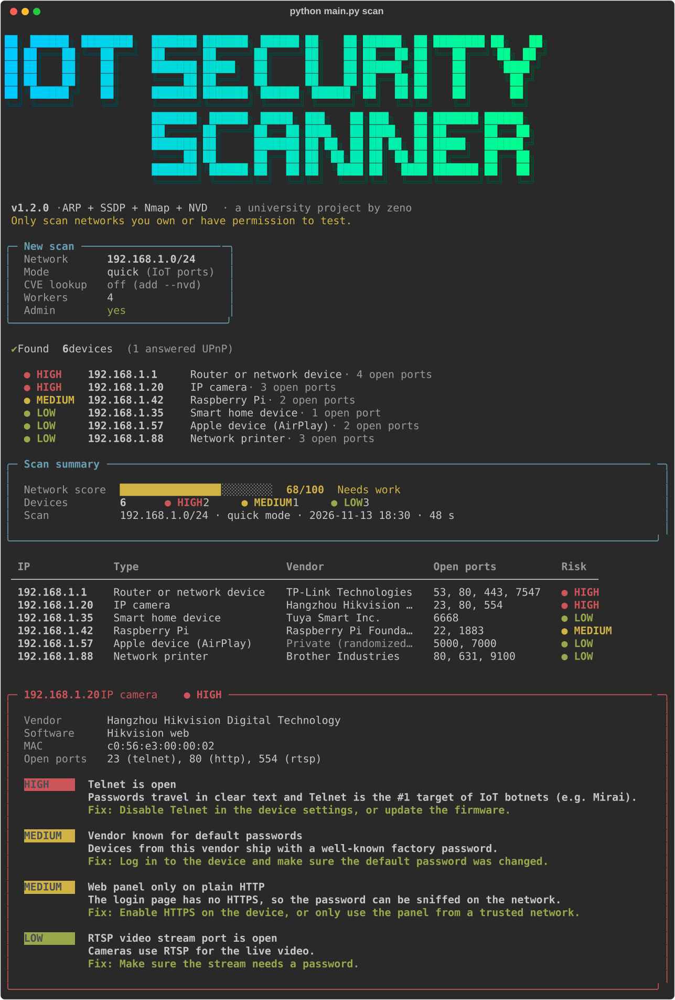

# IoT Security Scanner

[](https://github.com/zenobor/IoT_security/actions/workflows/tests.yml)


A university project about IoT security. It's a terminal tool written in Python that finds the devices on your home network, checks them for the most common IoT security problems and gives each one a risk level (LOW / MEDIUM / HIGH). For every problem it also tells you how to fix it.



<sub>Example output, made with demo data (not a real network).</sub>

> ⚠️ **Only use it on your own network, or on a network where you have permission to scan.**

## Why I made this

Cheap IoT devices (cameras, smart plugs, TV boxes, ISP routers...) are often the weakest point of a home network. The Mirai botnet got huge just by logging into devices that had Telnet open and the factory password. I wanted to see how my own devices were doing, and to understand how tools like Nmap work, so I built a small scanner that puts together the checks I studied in the course.

## What it checks

| Step | What happens |
| --- | --- |
| **Discovery** | ARP scan + SSDP/UPnP discovery, vendor from the MAC address, guess of the device type |
| **Ports and services** | Nmap on the ports IoT devices use (MQTT, RTSP, ADB, TR-069, Tuya...) |
| **IoT rules** | Telnet, FTP, plain HTTP, UPnP, ADB, TR-069, MQTT, vendors known for default passwords |
| **Full mode** | web panels without a login, old TLS, MQTT without a password, camera streams without a password, safe Nmap `vuln` scripts |
| **Known CVEs** (optional) | NVD API + the CISA list of actively exploited vulnerabilities (KEV) |

It **never guesses passwords** and **never changes anything** on the devices: every check is a normal, read-only request.

## How it works

```
ARP + SSDP  ->  Nmap  ->  identify device  ->  IoT rules  ->  CVEs / deep checks  ->  risk score  ->  reports
discovery.py    fingerprint.py                  rules.py       vuln_check.py           scoring.py      report.py
                                                               deep_checks.py
```

Devices are scanned in parallel (4 at a time by default) because most of the time is spent waiting for Nmap and the network. The terminal output is made with [rich](https://github.com/Textualize/rich).

## Setup

Requirements: **Python 3.11+** and **Nmap** (<https://nmap.org/download.html>, on Windows keep the **Npcap** option checked).

```powershell
git clone https://github.com/zenobor/IoT_security.git
cd IoT_security\iot-vuln-scanner
python -m venv .venv
.\.venv\Scripts\Activate.ps1          # Linux / macOS: source .venv/bin/activate
pip install -r requirements.txt
```

## Usage

**Windows, the easy way:** double-click `iot-vuln-scanner\start.bat`. It asks for administrator rights, installs the packages the first time and opens the menu.

From a terminal (open it **as Administrator**, on Linux use `sudo`):

```powershell
python main.py doctor              # check that Nmap, Npcap and admin rights are OK
python main.py                     # interactive menu
python main.py scan                # quick scan (the network is found automatically)
python main.py scan --mode full    # more ports + deep checks (slower)
python main.py scan --nvd          # also look up known CVEs online
python main.py show --map          # show the last scan again, with a network map
python main.py show --ip 192.168.1.20   # every issue of one device
python main.py compare             # what changed since the previous scan
python main.py demo                # example scan with made-up devices, for screenshots
```

All the options: `python main.py scan --help`. Default options can also go in a JSON file, see [config.example.json](iot-vuln-scanner/config.example.json).

Results are saved in `reports/` (Markdown report + JSON, optionally HTML and CSV). This folder is ignored by git because it contains information about your network.

## How the risk is calculated

Every problem adds points, e.g. SSH = 1, Telnet = 3, ADB = 4, critical CVE = 4-5.

| Points | Risk |
| --- | --- |
| 0-2 | LOW |
| 3-6 | MEDIUM |
| 7+ | HIGH |

The network score (0-100) is based on the average risk of the devices. All the weights are in [scoring.py](iot-vuln-scanner/src/scoring.py), with a comment explaining why.

## Project structure

```
iot-vuln-scanner/
├── start.bat            double-click launcher for Windows
├── main.py              command line (scan, doctor, show, compare, demo, menu)
├── data/                vendor list for the default-password check
├── src/
│   ├── discovery.py     ARP + SSDP
│   ├── fingerprint.py   Nmap, vendor, device type
│   ├── rules.py         IoT rules
│   ├── deep_checks.py   web panel, TLS, MQTT, RTSP checks (full mode)
│   ├── vuln_check.py    NVD + CISA KEV + Nmap vuln scripts
│   ├── scoring.py       risk points and network score
│   ├── findings.py      issue + fix texts
│   ├── report.py        Markdown / HTML / CSV / JSON
│   ├── demo.py          made-up network for "main.py demo"
│   └── terminal_report.py   everything printed in the terminal
└── tests/               pytest, no real network needed
```

## Tests

The tests replace every network call with fake data, so they run anywhere in a few seconds (they also run on GitHub Actions on Windows and Linux).

```powershell
pip install -r requirements-dev.txt
python -m pytest
```

## Limitations

- Only IPv4 and only the local network (ARP doesn't cross routers).
- The device type is a guess based on the MAC vendor and the open ports.
- "Vendor known for default passwords" is a reminder to check, not proof that the password is still the default one.
- Phones and laptops often use a random MAC address, so their vendor is unknown.

## License

MIT, see [LICENSE](LICENSE).
